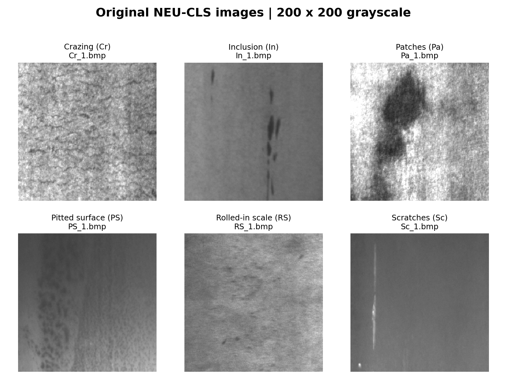
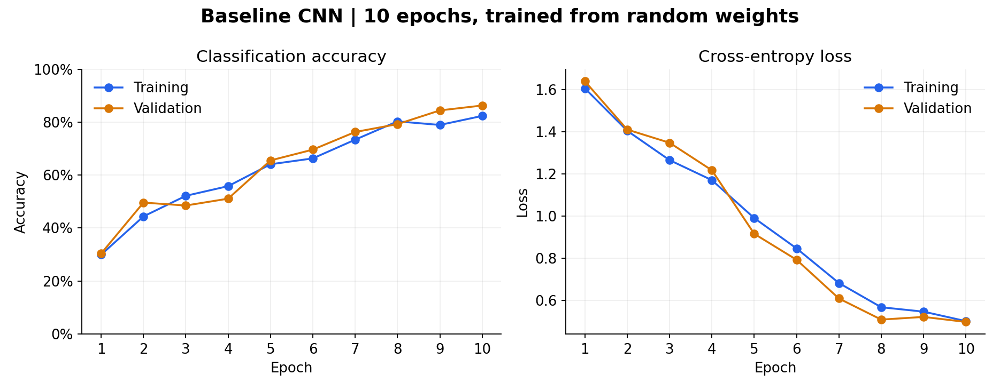
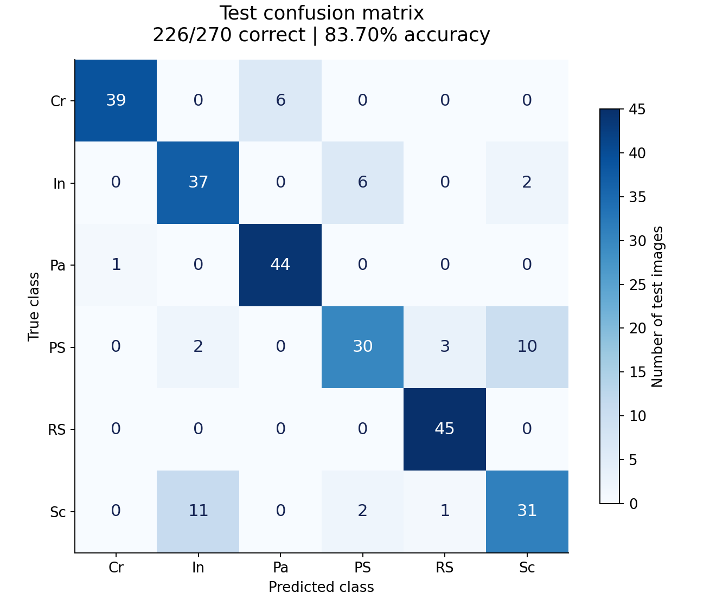
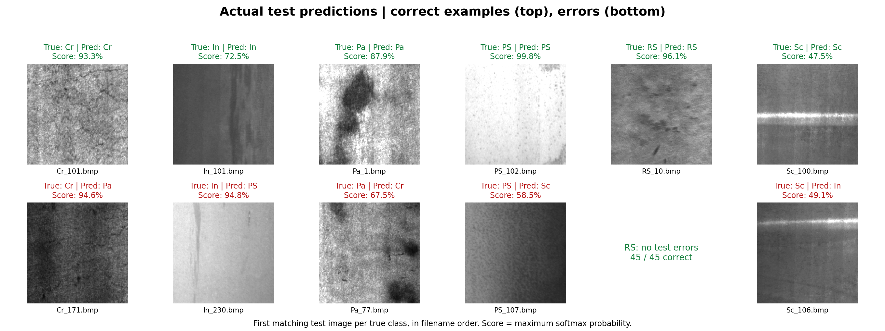

# Basic CNN for Steel Surface Defect Classification

A three-layer convolutional neural network built with PyTorch for six-class classification on NEU-CLS steel surface images. The model is trained from random weights.

**Recorded test result: 83.70% accuracy — 226 correct predictions out of 270 test images.**

## What do the original images look like?

Each input is a **200 × 200 grayscale image** of a steel surface. The examples below show one original image from each defect category, with its source filename. They are dataset illustrations, not a selection based on prediction quality.



| Code | Defect category |
| --- | --- |
| Cr | Crazing |
| In | Inclusion |
| Pa | Patches |
| PS | Pitted surface |
| RS | Rolled-in scale |
| Sc | Scratches |

The baseline converts grayscale pixel values to a tensor in the range [0, 1]. It uses no data augmentation. Its output is one class prediction per image; it does not draw bounding boxes or segment the defect.

## Model architecture

The architecture is defined in [models/simple_cnn.py](models/simple_cnn.py) by combining standard PyTorch layers.

| Stage | Operation | Output shape, excluding batch |
| --- | --- | --- |
| Input | Grayscale image converted to a tensor | 1 × 200 × 200 |
| Block 1 | 3×3 convolution + ReLU + 2×2 max pooling | 32 × 100 × 100 |
| Block 2 | 3×3 convolution + ReLU + 2×2 max pooling | 64 × 50 × 50 |
| Block 3 | 3×3 convolution + ReLU + 2×2 max pooling | 128 × 25 × 25 |
| Global pooling | Adaptive average pooling | 128 × 1 × 1 |
| Classifier | Flatten + fully connected layer | 6 class logits |

This repository contains the basic CNN experiment. The architecture uses standard building blocks and is not claimed as a novel network design.

## Training progress

The original run trained for 10 epochs using Adam, a learning rate of 0.001, a batch size of 16, and cross-entropy loss. The training seed was 42. The checkpoint with the highest validation accuracy was selected; ties kept the earlier epoch. The test set was not used for model selection.



Training accuracy increased from **29.94% to 82.37%**, and validation accuracy increased from **30.37% to 86.30%**. Epoch 10 was selected as the best checkpoint. The curves show training and validation measurements only.

## Final test results

These results come from the original baseline run, recorded on November 4, 2026. For this documentation update, the saved checkpoint was loaded and all 270 test predictions were independently checked against the saved prediction records. The model was not retrained.

| Measurement | Result |
| --- | --- |
| Best validation accuracy | 86.30% |
| Selected epoch | 10 / 10 |
| Test accuracy | **83.70%** |
| Correct / total test predictions | **226 / 270** |
| Incorrect predictions | 44 |
| Macro F1 score | 0.8346 |

### Confusion matrix

Rows are the true classes, and columns are the predicted classes. Diagonal entries count correct predictions. Each class has 45 test images.



| True class | Correct / test images | Recall |
| --- | --- | --- |
| Crazing (Cr) | 39 / 45 | 86.67% |
| Inclusion (In) | 37 / 45 | 82.22% |
| Patches (Pa) | 44 / 45 | 97.78% |
| Pitted surface (PS) | 30 / 45 | 66.67% |
| Rolled-in scale (RS) | 45 / 45 | 100.00% |
| Scratches (Sc) | 31 / 45 | 68.89% |

The model classified all 45 rolled-in scale images correctly in this test split. Its largest confusions were scratches predicted as inclusion (11 images), and pitted surface predicted as scratches (10 images).

### What do the predictions look like?

The top row shows a correct prediction for each true class. The bottom row shows an incorrect prediction for each class that had errors. Examples are selected as the first matching image in the saved, filename-sorted test records. Rolled-in scale has no error example because all 45 test images were classified correctly.



Each score is the maximum softmax probability, not a calibrated guarantee that the prediction is correct. The displayed images are the original test inputs; the text above each image is the model's classification result.

The underlying [metrics](results/baseline_run_001/test_metrics.json), [per-image predictions](results/baseline_run_001/test_predictions.csv), [training history](results/baseline_run_001/history.csv), and [configuration](results/baseline_run_001/config.json) are included for inspection. These measurements describe one run on one dataset split; results may vary across environments.

## Dataset and split

The original dataset contains 1,800 BMP images. Before splitting, images are deduplicated using SHA-256 hashes of their grayscale pixel content. One duplicate pair is found: `Pa_105.bmp` and `Pa_101.bmp`. Only `Pa_101.bmp` participates in the experiment; the source files are preserved.

| Split | Unique images |
| --- | --- |
| Training | 1,259 |
| Validation | 270 |
| Test | 270 |
| Total | 1,799 |

The split is stratified by class, uses seed 42, and follows an approximately 70% / 15% / 15% ratio. The persisted [split manifest](data/splits/NEU-CLS_deduplicated_v1.json) is checked against the image contents whenever data is loaded.

Pixel deduplication removes exact duplicates, including differently encoded images with the same grayscale pixels. It does not establish independence between different photos of the same physical sample or exclude all near-duplicates.

### Prepare the data

Obtain NEU-CLS separately and place the 1,800 original BMP images directly inside `data/NEU-CLS/`, without per-class subdirectories:

```text
data/
  NEU-CLS/
    Cr_1.bmp
    In_1.bmp
    Pa_1.bmp
    PS_1.bmp
    RS_1.bmp
    Sc_1.bmp
    ...
  splits/
    NEU-CLS_deduplicated_v1.json
```

Class labels are read from filename prefixes. Only small example panels are included in this README; the full dataset and model weights are not distributed in the repository.

If your data does not match the saved manifest, loading fails rather than silently changing the experiment. First check that you have the same original dataset. To intentionally use a different dataset version, back up and move the old manifest, generate a new one, and retrain. Checkpoints from different splits cannot be mixed.

## Installation

Python 3.10 is recommended. From the repository directory, create and activate a virtual environment.

**Windows PowerShell**

```powershell
python -m venv .venv
.\.venv\Scripts\Activate.ps1
python -m pip install -r requirements.txt
```

**macOS / Linux**

```bash
python -m venv .venv
source .venv/bin/activate
python -m pip install -r requirements.txt
```

The original run used PyTorch 2.5.1 with CUDA 12.1. The scripts automatically use CUDA when available and otherwise run on CPU. Choose a compatible PyTorch installation for your hardware if necessary.

## Train and evaluate

```console
python data_split.py
python train.py
python evaluate.py
```

Each training run creates a new directory under `outputs/leak_free/simple_cnn/`, such as `run_001/`, without overwriting older runs. Outputs include training history, the best checkpoint, and a snapshot of the data split. Evaluation uses the latest completed run, validates checkpoint provenance, and saves metrics, per-image predictions, and a confusion matrix.

## Checks and figure reproduction

```console
python models/simple_cnn.py
python -m unittest discover -s . -p test_data_split.py -v
```

The first command checks model input and output shapes. The nine regression checks cover pixel deduplication, persistent splits, dataset changes, and checkpoint/split matching.

To reproduce the README figures, supply the original dataset and the original run directory containing `best_model.pth` and its experiment records:

```console
python tools/build_readme_figures.py --data-dir /path/to/NEU-CLS --run-dir /path/to/run_001
```

This command independently verifies every test prediction before rebuilding the figures and copying the recorded results. The original checkpoint is required and is not included in this repository. The committed results and figures can be viewed without it.

## Project files

| Path | Purpose |
| --- | --- |
| `models/simple_cnn.py` | Three-layer baseline CNN |
| `data_split.py` | Pixel deduplication and persistent data splits |
| `dataset.py` | Grayscale image loading and tensor conversion |
| `experiments.py` | Training, checkpoint selection, and test evaluation |
| `train.py` / `evaluate.py` | Training and evaluation entry points |
| `test_data_split.py` | Data integrity and checkpoint regression checks |
| `docs/images/` | Original-image examples and result figures |
| `results/baseline_run_001/` | Original experiment records, excluding weights |
| `tools/build_readme_figures.py` | Prediction verification and figure generation |
